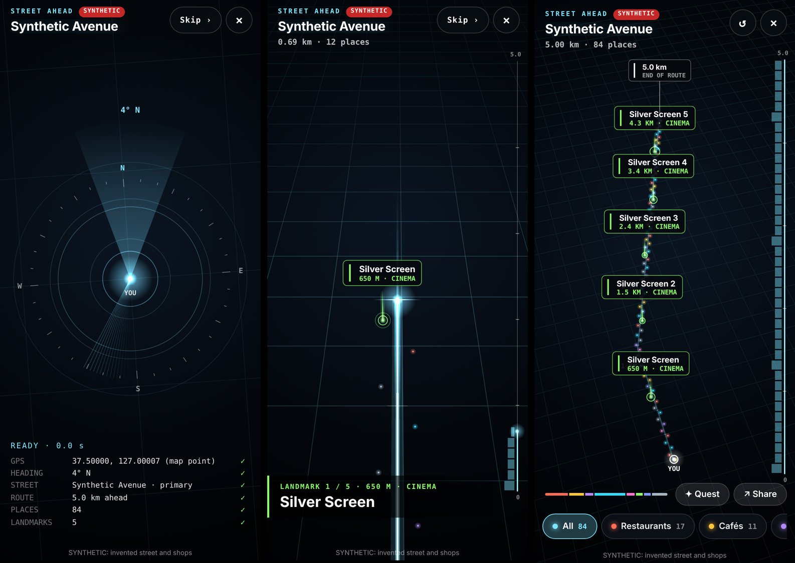
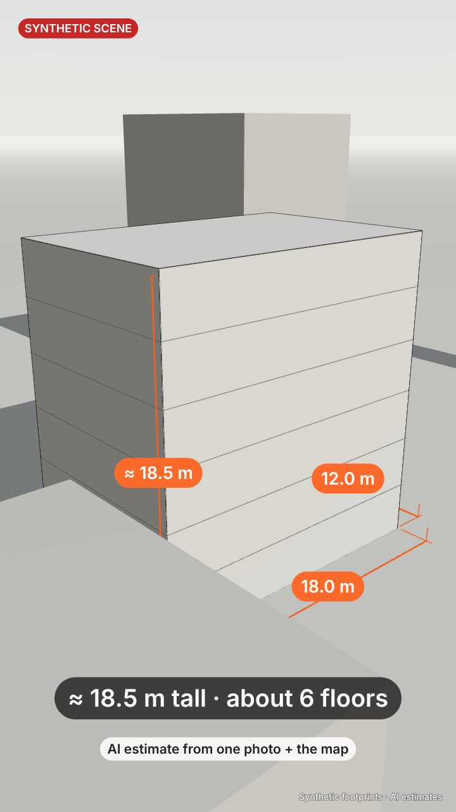

# What's Ahead

Two modes, one camera:

- **What's Ahead** (the default): stand on a street, point your phone down it and take one photo. The map works out which street you are on and which way you are looking; then, on black, a light runs 5 km down the street from where you stand, dotting every place the map knows at its distance and side and stopping to name the landmarks. Tap Restaurants, Cafés, Shops or Entertainment and the light runs the street again for just those.
- **Building what-if** (`/?mode=building`): point your phone at a building. One photo and the map turn it into a 3D model with its measurements, and then it shows what the building could become: a garden on the roof, green climbing up the walls, warm light after sunset. The result is a 9:16 video made for sharing.

The project started as What If Camera; the repository, the package and the deployment (https://whatif-camera.vercel.app) keep that name, and the code calls the street mode Street Ahead. Entry for the Meta Global AI Developer Hackathon (October to November 2026). Operator: Minwoo Kwon (`seegongsik`). License: MIT.

Shop data is what OpenStreetMap has mapped, shown with its source; shops change. Heights, floors and designs are estimates and ideas, shown as such. A real roof garden needs a structural check.

## What's Ahead



1. **Which street**: the photo's GPS fix and compass heading go to `/api/street`. The server reads OpenStreetMap's named roads around from OpenFreeMap's vector tiles (a CDN, so quick; the Overpass API only when the tiles cannot place the camera on a named street) and picks the one that runs beside the camera in the direction it faces: within 40° of the heading, nearer and straighter first, main roads and named roads ahead of service lanes; within 45 m, or within 120 m when none is that near (a GPS fix between tall buildings is often that far off; the page then says how far). A starting point picked from the home page also sends the street's name, which picks it out.
2. **5 km ahead**: the route follows that road through every junction: the way that carries the same name (or road number) first, if it turns no more than 60°; otherwise the straightest one within 30°. It stops at 5 km or where the road ends.
3. **Shops along it**: every named place within a corridor of the route (25 to 60 m each side by road class): food, cafés, bars, fashion, groceries, beauty, health, banks, things to do, places to stay and other shops. Each gets its distance along the street and its side. The places come from **Overture Maps** (the Overture Maps Foundation, which Meta co-founded; most of its places come from Meta's place data, so many have a Facebook page and a website), read straight from its public release; when Overture cannot answer, from OpenStreetMap. A street keeps at most 400 places (Overture's most certain ones, then those with links); a place mapped twice shows once.
4. **While it is worked out** (about 3 to 6 s): the photo is scanned top to bottom and folds into a dot, your position, on a radar: pulses, a compass turned to the map's north, the direction you face. Beside it the readings come in line by line, real values only: the photo's size, the GPS fix and its accuracy, the heading; then, when the server answers, the street and its road class, the route length, the number of places (and how many were found), the landmarks, the sources and any fallback taken, with the time the lookup took.
5. **The light**: the camera tilts from straight down to behind you and a light runs from your dot down the street, drawing it as it goes over a perspective grid. Every place lights up as a dot in its kind's colour when the light passes it, on its side of the street. At each landmark the light slows: the place flashes, its name, distance and kind come up in a tag beside the street, and the name comes up large at the bottom like a film's lower third. The camera chases the light with a lag, so the light shoots up the screen between landmarks and the camera settles on each one. A ruler on the right shows how far the light has got and how many places each stretch holds. Then the camera rises to show the whole street with its landmarks (about 10 s for 5 km; Skip jumps there).
   Name tags go on the place's own side of the street (a place on the left gets its tag to the left), stacked in a column on each side in the order of the places, facing the street, with a line back to the place. They keep clear of the street's line, behind the light and ahead of it, and of the caption at the bottom. Long names wrap onto two lines.
6. **Tours**: chips at the bottom (Restaurants, Cafés, Bars, Shops, Beauty, Entertainment, Hotels, Services, with their counts and a bar of the street's mix) send the light down the street again in that kind's colour, lighting only those places, counting them up and naming the best ones (picked like landmarks, within the kind). "All" runs it again for every place. Tap a dot or a name for the place's card: kind, distance and side, hours as mapped, Instagram, Facebook and website links when the data has them, and the other places at the same spot.
7. **Landmarks**: no visitor numbers exist in the data, so they are picked from what the map says: a sight by its kind (museums, department stores and malls, theatres and cinemas, hotels), or a brand found only once on this street (more so with "flagship" or the street's own name in the place's name, as "Apple Fifth Avenue"); then the source's confidence and links. Chain restaurants, clinics, banks, guest houses and addresses ("608 Fifth Avenue") rank low. One per 600 m or so, at least half that apart, three to eight.
8. **Signs in the photo** (Muse Spark Open): the photo and the names of the nearest mapped places go to the model, which says which names it can actually read in the picture (and where: left, middle or right). Read ones get a ✓ on their tags and cards and a line says "Right street, right way"; a photo of building fronts says what to try instead. The model answers with ids from the list and fixed words only.
9. **Quest** (Muse Spark Open): pick a theme (coffee and a browse, lunch break, evening out, rainy day, with kids, surprise me) and the model picks two to four stops along the street, in walking order, with a title and one line per stop. It is told each place's kind, side, distance and mapped hours, never its name; its text may hold no digits and no business names (checked; a line that fails is replaced by a plain one). The light then runs to the stops in gold, numbered, with each stop's line under its name. Without the model the app picks the stops itself and says so.
10. **Share**: a 1080 × 1920 card in the same look (the whole street with its landmarks or the quest's stops in columns beside it, the count of each kind, the photo in a circle, the map's credits in full) through the phone's share sheet, for Instagram Stories, WhatsApp and the rest; saved as a picture where sharing files is not supported.

The street is drawn as a diagram, not a picture of it: its line and the distances along it come from the map; each place's dot stands on its side 8 to 24 m from the line (its mapped offset, kept in that range so dots neither sit on the line nor stray). Colours come from the kind of place, never logos. Without a photo, `/?street=lat,lon,heading[,name]` (or a starting point on the home page) starts from the map alone; `/?demo=street` opens the SYNTHETIC street (invented street and shops, labelled SYNTHETIC). With reduced motion set on the device, the show goes straight to the whole street.

## Building what-if (`/?mode=building`)



### The idea: the top view is the ruler for the front view

A photo alone has no scale. The map does: the building's footprint (the top view) says how wide each wall is and where its corners stand. The photo (the front view) says in which direction each corner lies and how high the roof line rises. Put together:

1. The two outer vertical edges of the building are seen a certain angle apart. Every camera position on one circle sees them that far apart; the footprint fixes the circle, so the distance to the building is known.
2. The roof is taken to stand at the same height at both outer edges (a flat roof, an assumption). That fixes how much nearer one edge is than the other, and with it the camera's place on the circle.
3. If two sides show, a fifth mark on the near corner pins the position and the heading down independently (three-point resection).
4. With the distances known, height = distance × (tan of the angle up to the roof line − tan of the angle down to the wall foot).

GPS and compass only seed this. They enter as priors with their own uncertainty, so a GPS fix 9 m off or a compass 11° off is corrected by the picture rather than trusted (see the synthetic check below).

### What it does

1. **Capture**: the camera with a live readout of heading, tilt and GPS accuracy. The still keeps the GPS fix, the compass heading and the gravity tilt. Without motion sensors (or for an uploaded photo) the tilt is read from the photo itself: the building's vertical edges meet at a vanishing point that fixes pitch and roll.
2. **Which building**: OpenStreetMap footprints within 150 m on a top view. Rays swept across the view pick the building in the middle of the picture; tap another if it is wrong.
3. **Mark**: drag four dots to the outer left and right edges at the roof line and at the ground (a loupe helps), and optionally a fifth on the near corner. Measuring waits until the dots have been placed by hand, so the sensors' first guess is never shown as a measurement.
4. **Estimate**: the photo is registered to the map, then height and floors come out (floors from OpenStreetMap `building:levels` when mapped, otherwise height ÷ 3 m, an assumption).
5. **Design**: Muse Spark Open looks at the photo and the measured facts and chooses from a short menu (deck, planters, trees, pergola, seating, string lights, vines, window boxes, awning, wall lights, colours, captions). It never places anything or writes a number: the layout code places every item on the measured roof and walls. Without a key the app uses its local plan and says so.
6. **Video** (rendered in the browser with three.js, about 27 s):
   - the photo itself, then the camera moves and the photo's building turns solid (the photo is projected back onto the 3D scene from the camera that took it, so the first frame is the photo pixel for pixel);
   - the camera stays on the photo's side of the building, where the picture covers the scene: it pushes in, swings toward the main facade and rises to the roof line. Once it moves, the road and cars in front of the building are left out of the projection, so they do not smear across the ground;
   - the photo stays on every wall it saw. The selected building's unseen walls get a drawn facade (a window grid on the storey height, the wall colour taken from the photo); other buildings stay plain there. Floor lines and dimension lines show during the measurement (width and depth from the map, height marked ≈);
   - the garden grows, the vines climb, the sun goes down at the real evening sun position for that place and date, the lights and some windows come on;
   - back to the exact photo viewpoint for a before/after wipe.
7. **Record and share**: the canvas is recorded (MP4 where the browser can, otherwise WebM) with the map attribution and estimate labels burned in.

### Demo and real use: one pipeline

- **Live**: `Open camera` on a phone (HTTPS needed, so use the Vercel deployment).
- **Use a photo**: location, heading and focal length are read from EXIF when present; otherwise type them. Tilt comes from the building's edges.
- **Preset**: `Save preset` writes one JSON file with the photo, what the phone knew, the footprints as fetched, the pick, the marks and the plan. `/?preset=/presets/name.json&autoplay=1` replays it straight into the video, offline and identical every time; `&size=1080` renders 1080 × 1920 for the demo recording. See `public/presets/README.md`.
- **Synthetic demo**: `/?demo=synthetic` (labeled SYNTHETIC everywhere). Invented buildings around a placeholder location and a photo rendered from a known camera; the app gets only what a phone would know (a GPS fix 9.2 m off, a compass 11° off, no height for the target) and the facts panel compares its answers with the truth.

### Synthetic check

SYNTHETIC numbers from this repository, not real-world accuracy (that is not measured yet):

| Case (GPS fix about 9 m off, compass about 11° off) | Height (true 18.6 m) | Camera position error | Heading error |
| --- | --- | --- | --- |
| Synthetic demo in the browser: marks within 1.5 px, near corner marked, gravity tilt | 18.54 m | 0.08 m | 0.02° |
| Unit test scene: four marks within 1.5 px, no near corner | 18.68 m | 1.5 m | 1.7° |
| Upload path in the browser: no sensors, tilt read from the photo (13.0°, true 14°), heading typed | 18.5 m | not recorded | corrected by 10.9° (error was 11°) |

## Models

| Role | Model | Where | Status |
| --- | --- | --- | --- |
| Design choices and captions from the photo and the facts | `meta-models/muse-spark-open-1026` | Baseten, OpenAI-compatible Chat Completions | wired; used when `BASETEN_API_KEY` is set |
| What's Ahead: which mapped places' names are readable in the photo | `meta-models/muse-spark-open-1026` | Baseten | wired (`/api/signs`); used when `BASETEN_API_KEY` is set |
| What's Ahead: quest stops by id, a title and a line per stop | `meta-models/muse-spark-open-1026` | Baseten | wired (`/api/quest`); the app's own pick without a key |
| Building outline and corners from a tap (automatic marks) | `sam-3.1` | Meta Model API | planned; not called before the hackathon credits are confirmed |

When the model is configured, the photo (downscaled to 1024 px) and the measured facts or the nearest places' names are sent to it through the app's server; nothing is stored there. The quest request carries no names and no photo. Muse Wonder is documented as unavailable in South Korea, so it is not used. The video is rendered, not generated: a video model would not keep the floor count and the dimension lines consistent from frame to frame.

## Data

| Data | Source | License |
| --- | --- | --- |
| Building footprints, `height`, `building:levels` | OpenStreetMap via the Overpass API: `overpass-api.de`, then `overpass.private.coffee` (8 s each) | ODbL, "© OpenStreetMap contributors" shown on screen and in videos |
| Fallback footprints when every Overpass server is full | OpenStreetMap vector tiles from OpenFreeMap (OpenMapTiles schema, zoom 14, `building` layer); their heights are approximate and used for neighbours only | ODbL; "© OpenStreetMap contributors · OpenMapTiles · OpenFreeMap" |
| Streets for What's Ahead: named roads (`transportation_name` layer) and, as a fallback, places with their kind (`poi` layer; offices and bike docks left out) | OpenFreeMap vector tiles (OpenMapTiles schema, zoom 14, up to 12 tiles along the heading) | ODbL; "© OpenStreetMap contributors · OpenMapTiles · OpenFreeMap" |
| Places along the street: name, kind (`basic_category`, `taxonomy.primary`), confidence, websites, socials (Facebook pages), brand, position | Overture Maps places, release 2026-10-21.0, GeoParquet in the public bucket `overturemaps-us-west-2`: only the row groups that meet the street (`server/data/overture-places.ts`, made by `node scripts/overture-index.mjs`) and only these columns, with HTTP range requests; confidence 0.5 and up, open places, street-level kinds | CDLA-Permissive-2.0, "Places © Overture Maps Foundation" on screen |
| Fallback street when the tiles cannot place the camera (roads with their nodes, `name`, `ref`), and shops when Overture is off (`shop`, `amenity`, `tourism`, `leisure` with `name`, `brand`, `opening_hours`, `cuisine`, `website`, `contact:instagram`, `contact:facebook`) | OpenStreetMap via the Overpass API (same servers as above; boxes along the street rather than a distance from it; 20 s in all). The answer's `notes` say why a fallback was used | ODbL, "© OpenStreetMap contributors" on screen |
| Sun position | Astronomical Almanac low-precision formulas | computed |

## Assumptions

What's Ahead: a compass within 40° of a street's direction means the camera looks along it; landmarks are a ranking from what the map says (kind, brand, name, confidence, links), not a measure of how famous a place is.

Building what-if, listed in the facts panel whenever they are used: the roof stands at the same height at both outer edges (flat roof); 3.0 m per floor when OpenStreetMap has no level count; 1.5 m camera height when the foot of the walls is hidden; 67° field of view across the long side for a live capture (a typical 26 mm equivalent main camera; EXIF focal length for uploads); 9 m for neighbouring buildings without a mapped height (context only); compass uncertainty 20° when the phone reports none. Sizes of the decorations are design choices, not measurements.

## Run locally

```bash
npm install
npm test          # geometry, registration, height, tilt, EXIF, Overpass parsing, routes, plan, layout, timeline
npm run lint
npm run build
npm run check:api # transpiles the API functions file by file and calls them without keys
npm run dev       # http://localhost:5173/?demo=street (SYNTHETIC street), ?demo=synthetic&mode=building
```

## Secrets and settings

Server side only; `/api/status` returns booleans.

| Variable | Use |
| --- | --- |
| `BASETEN_API_KEY` | Muse Spark Open on Baseten |
| `MODEL_API_KEY` (or `META_API_KEY`) | Meta Model API (SAM 3.1), not called yet |
| `OVERPASS_URLS` (or `OVERPASS_URL`) | Overpass API instances to try first, comma-separated, HTTPS only |
| `FOOTPRINT_TILES` | `off` disables the vector-tile fallback |
| `OVERTURE_PLACES` | `off` takes the places from OpenStreetMap only |
| `DAILY_FOOTPRINT_CALL_CAP`, `DAILY_SPARK_CALL_CAP`, `DAILY_STREET_CALL_CAP` | per-instance daily caps (defaults 2000, 300 and 2000) |

## Open source used

| Package | Role | License |
| --- | --- | --- |
| `three` (with its `examples/jsm` lines and BufferGeometryUtils) | 3D rendering | MIT |
| `hyparquet` | Reads Overture's Parquet files on the server (row groups and columns by range request; zstd through Node's own `zlib`) | MIT |
| `vite`, `vitest` | build, dev server, tests | MIT |
| `typescript`, `typescript-eslint`, `eslint`, `@eslint/js`, `globals`, `@types/three`, `@types/node` | types and lint | Apache-2.0 / MIT |

All application code was written in this repository during the hackathon (from 2026-10-27 02:00 KST).

## Limits

What's Ahead:

- Only what OpenStreetMap has mapped, as it was mapped: shop coverage, names and opening hours vary by city, and shops close and open. The card says so and names the source.
- The street is matched from GPS and compass alone. On a corner or under tall buildings the GPS fix can sit on the cross street; the app shows which street it took (its name at the top, and how far from your position when it had to look wider), and the sign check says whether the photo fits it.
- A street that changes name keeps going only if the next way runs straight on; a dual carriageway mapped as two one-way roads is followed along the carriageway beside the camera.
- Roads without a name cannot be matched. When Overture cannot answer, places come from the map tiles and carry only their kind: no hours, links or brands.
- Overture's places are a monthly snapshot (release 2026-10-21.0; older releases leave the bucket after a few months, so the index is remade for a new one). Its place data has no opening hours; many places are on upper floors rather than at street level.
- Quest lines are ideas from the kind of place, not reviews; hours are as mapped and may be out of date. The sign check only knows names on the map: a sign it reads that the map lacks is not reported.
- Landmarks are guessed from the data, not from visitor numbers: a famous place the data files under an everyday kind, or without a brand, can be missed, and an obscure one can be picked.
- Not yet tried by a person standing on a real street with a phone; the starting points on the home page run the deployed lookup on real map data.

Building what-if:

- Flat roofs and simple outlines. A pitched roof, a setback or a rooftop structure breaks the same-height assumption; marks must sit on the building's outermost vertical edges.
- Buildings joined to their neighbours: the outer edge seen in the photo may not be the footprint's outermost corner.
- OpenStreetMap coverage and tags vary by place; where the footprint is missing the app cannot place the photo.
- Portrait capture only. The compass is magnetic; the registration absorbs the declination along with the compass error.
- Interior layouts are not shown: they cannot be seen from outside.
- One photo sees one side. What stood in front of the building (cars, trees) is painted onto the walls and the ground, and parts the photo did not see show plain walls; the camera therefore stays near the photo's viewpoint. Map boxes taller than the real building (a curved roof) can show sky at their top edge when the camera rises. Masks from SAM 3.1 (sky, foreground) are the planned fix.
- The floor count is height ÷ 3.0 m unless OpenStreetMap has `building:levels`; older and civic buildings with tall storeys come out with too many floors.
- Window boxes are left out for real photos until the window positions are measured; the design model may still choose them.
- A cropped photo (a screenshot) has its optical centre off the middle; a preset can carry it as `capture.principalPoint`, the live app assumes the middle.
- The public Overpass servers are often full (on 2026-10-27 overpass-api.de answered "at capacity" to every lookup from the deployment); lookups fall back to a second server and then to vector tiles. A building that straddles a tile border is cut in two in the tile fallback.
- Real-phone checks of the orientation on iOS and Android, real buildings with known heights and SAM 3.1 automatic marks are next (`PROGRESS.md`).
