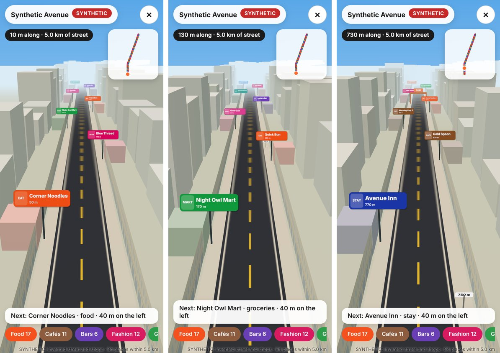

# What If Camera

Two modes, one camera:

- **Street Ahead** (the default): stand on a street, point your phone down it and take one photo. The map works out which street you are on and which way you are looking, and every shop it knows for the next 5 km appears where it stands: "Corner Noodles, 50 m ahead on the left". The nearest ones are labelled on the photo; scroll, and the view flies down the street past each shop's sign.
- **Building what-if** (`/?mode=building`): point your phone at a building. One photo and the map turn it into a 3D model with its measurements, and then it shows what the building could become: a garden on the roof, green climbing up the walls, warm light after sunset. The result is a 9:16 video made for sharing.

Entry for the Meta Global AI Developer Hackathon (October to November 2026). Operator: Minwoo Kwon (`seegongsik`). License: MIT.

Shop data is what OpenStreetMap has mapped, shown with its source; shops change. Heights, floors and designs are estimates and ideas, shown as such. A real roof garden needs a structural check.

## Street Ahead



1. **Which street**: the photo's GPS fix and compass heading go to `/api/street`. The server asks OpenStreetMap (Overpass API) for the roads around and picks the one that runs beside the camera in the direction it faces: within 40° of the heading, nearer and straighter first, main roads and named roads ahead of service lanes; within 45 m, or within 120 m when none is that near (a GPS fix between tall buildings is often that far off; the page then says how far). A starting point picked from the home page also sends the street's name, which picks it out.
2. **5 km ahead**: the route follows that road through every junction: the way that carries the same name (or road number) first, if it turns no more than 60°; otherwise the straightest one within 30°. It stops at 5 km or where the road ends.
3. **Shops along it**: every named place within a corridor of the route (25 to 60 m each side by road class): food, cafés, bars, fashion, groceries, beauty, health, banks, things to do, places to stay and other shops. Each gets its distance along the street and its side. The places come from **Overture Maps** (the Overture Maps Foundation, which Meta co-founded; most of its places come from Meta's place data, so many have a Facebook page and a website), read straight from its public release; when Overture cannot answer, from OpenStreetMap. A street keeps at most 400 places (Overture's most certain ones, then those with links); a place mapped twice shows once.
4. **On the photo**: the nearest shops in view are labelled where their signs hang, with the camera that took the photo. When the compass points within 25° of the street, the camera is taken to look along it (phone compasses are often 10 to 20° off between buildings).
5. **Down the street**: scrolling flies a drone camera along the route. Each place is a pin in its category's colour, on its side at its distance; places within 9 m share a pin. The pins in the next 300 m carry name tags laid out on the screen the way a map lays out its labels: white tags with the name and the distance ("+2 here" when places share a pin), larger when near, never on top of one another or under the bars, at most 14 at a time; a tag that has no room is lifted once on a leader line or left out. A post every 250 m and an arch every kilometre; a small map shows where you are (tap it to jump); chips filter the kinds of places; "Next:" names the next place ahead, and its tag is outlined. Tap a tag (or a pin) for its card: kind of place, opening hours as mapped, its Instagram, Facebook and website links when the data has them, and the other places at the same pin.
6. **Signs in the photo** (Muse Spark Open): the photo and the names of the nearest mapped places go to the model, which says which names it can actually read in the picture (and where: left, middle or right). Read ones get a ✓ on the photo and a line says "Right street, right way"; none read, or a photo of building fronts, says what to try instead. The model answers with ids from the list and fixed words only.
7. **Quest** (Muse Spark Open): pick a theme (coffee and a browse, lunch break, evening out, rainy day, with kids, surprise me) and the model picks two to four stops along the street, in walking order, with a title and one line per stop. It is told each place's kind, side, distance and mapped hours, never its name; its text may hold no digits and no business names (checked; a line that fails is replaced by a plain one). The stops get numbered pillars of light, gold-ringed signs and stars on the small map; scrolling past each one ticks it off. Without the model the app picks the stops itself and says so.
8. **Share**: a 1080 × 1920 card (the photo, the street's name, the quest or the next places, the map's credit) through the phone's share sheet, for Instagram Stories, WhatsApp and the rest; saved as a picture where sharing files is not supported.

The street is drawn as a toy street: distances along it and the side of each shop are to scale, road widths and building sizes are not (the road is drawn narrower so both rows of signs fit a phone screen). Signs show names in category colours, not logos. Without a photo, `/?street=lat,lon,heading` (or a starting point on the home page) flies down a street from the map alone; `/?demo=street` opens the SYNTHETIC street (invented street and shops, labelled SYNTHETIC).

## Building what-if (`/?mode=building`)


### The idea: the top view is the ruler for the front view

A photo alone has no scale. The map does: the building's footprint (the top view) says how wide each wall is and where its corners stand. The photo (the front view) says in which direction each corner lies and how high the roof line rises. Put together:

1. The two outer vertical edges of the building are seen a certain angle apart. Every camera position on one circle sees them that far apart; the footprint fixes the circle, so the distance to the building is known.
2. The roof is taken to stand at the same height at both outer edges (a flat roof, an assumption). That fixes how much nearer one edge is than the other, and with it the camera's place on the circle.
3. If two sides show, a fifth mark on the near corner pins the position and the heading down independently (three-point resection).
4. With the distances known, height = distance × (tan of the angle up to the roof line − tan of the angle down to the wall foot).

GPS and compass only seed this. They enter as priors with their own uncertainty, so a GPS fix 9 m off or a compass 11° off is corrected by the picture rather than trusted (see the synthetic check below).

### What it does

1. **Capture**: the camera with a live readout of heading, tilt and GPS accuracy. The still keeps the GPS fix, the compass heading and the gravity tilt. Without motion sensors (or for an uploaded photo) the tilt is read from the photo itself: the building's vertical edges meet at a vanishing point that fixes pitch and roll.
2. **Which building**: OpenStreetMap footprints within 150 m on a top view. Rays swept across the view pick the building in the middle of the picture; tap another if it is wrong.
3. **Mark**: drag four dots to the outer left and right edges at the roof line and at the ground (a loupe helps), and optionally a fifth on the near corner. Measuring waits until the dots have been placed by hand, so the sensors' first guess is never shown as a measurement.
4. **Estimate**: the photo is registered to the map, then height and floors come out (floors from OpenStreetMap `building:levels` when mapped, otherwise height ÷ 3 m, an assumption).
5. **Design**: Muse Spark Open looks at the photo and the measured facts and chooses from a short menu (deck, planters, trees, pergola, seating, string lights, vines, window boxes, awning, wall lights, colours, captions). It never places anything or writes a number: the layout code places every item on the measured roof and walls. Without a key the app uses its local plan and says so.
6. **Video** (rendered in the browser with three.js, about 27 s):
   - the photo itself, then the camera moves and the photo's building turns solid (the photo is projected back onto the 3D scene from the camera that took it, so the first frame is the photo pixel for pixel);
   - the camera stays on the photo's side of the building, where the picture covers the scene: it pushes in, swings toward the main facade and rises to the roof line. Once it moves, the road and cars in front of the building are left out of the projection, so they do not smear across the ground;
   - the photo stays on every wall it saw. The selected building's unseen walls get a drawn facade (a window grid on the storey height, the wall colour taken from the photo); other buildings stay plain there. Floor lines and dimension lines show during the measurement (width and depth from the map, height marked ≈);
   - the garden grows, the vines climb, the sun goes down at the real evening sun position for that place and date, the lights and some windows come on;
   - back to the exact photo viewpoint for a before/after wipe.
7. **Record and share**: the canvas is recorded (MP4 where the browser can, otherwise WebM) with the map attribution and estimate labels burned in.

### Demo and real use: one pipeline

- **Live**: `Open camera` on a phone (HTTPS needed, so use the Vercel deployment).
- **Use a photo**: location, heading and focal length are read from EXIF when present; otherwise type them. Tilt comes from the building's edges.
- **Preset**: `Save preset` writes one JSON file with the photo, what the phone knew, the footprints as fetched, the pick, the marks and the plan. `/?preset=/presets/name.json&autoplay=1` replays it straight into the video, offline and identical every time; `&size=1080` renders 1080 × 1920 for the demo recording. See `public/presets/README.md`.
- **Synthetic demo**: `/?demo=synthetic` (labeled SYNTHETIC everywhere). Invented buildings around a placeholder location and a photo rendered from a known camera; the app gets only what a phone would know (a GPS fix 9.2 m off, a compass 11° off, no height for the target) and the facts panel compares its answers with the truth.

### Synthetic check

SYNTHETIC numbers from this repository, not real-world accuracy (that is not measured yet):

| Case (GPS fix about 9 m off, compass about 11° off) | Height (true 18.6 m) | Camera position error | Heading error |
| --- | --- | --- | --- |
| Synthetic demo in the browser: marks within 1.5 px, near corner marked, gravity tilt | 18.54 m | 0.08 m | 0.02° |
| Unit test scene: four marks within 1.5 px, no near corner | 18.68 m | 1.5 m | 1.7° |
| Upload path in the browser: no sensors, tilt read from the photo (13.0°, true 14°), heading typed | 18.5 m | not recorded | corrected by 10.9° (error was 11°) |

## Models

| Role | Model | Where | Status |
| --- | --- | --- | --- |
| Design choices and captions from the photo and the facts | `meta-models/muse-spark-open-1026` | Baseten, OpenAI-compatible Chat Completions | wired; used when `BASETEN_API_KEY` is set |
| Street Ahead: which mapped places' names are readable in the photo | `meta-models/muse-spark-open-1026` | Baseten | wired (`/api/signs`); used when `BASETEN_API_KEY` is set |
| Street Ahead: quest stops by id, a title and a line per stop | `meta-models/muse-spark-open-1026` | Baseten | wired (`/api/quest`); the app's own pick without a key |
| Building outline and corners from a tap (automatic marks) | `sam-3.1` | Meta Model API | planned; not called before the hackathon credits are confirmed |

When the model is configured, the photo (downscaled to 1024 px) and the measured facts or the nearest places' names are sent to it through the app's server; nothing is stored there. The quest request carries no names and no photo. Muse Wonder is documented as unavailable in South Korea, so it is not used. The video is rendered, not generated: a video model would not keep the floor count and the dimension lines consistent from frame to frame.

## Data

| Data | Source | License |
| --- | --- | --- |
| Building footprints, `height`, `building:levels` | OpenStreetMap via the Overpass API: `overpass-api.de`, then `overpass.private.coffee` (8 s each) | ODbL, "© OpenStreetMap contributors" shown on screen and in videos |
| Fallback footprints when every Overpass server is full | OpenStreetMap vector tiles from OpenFreeMap (OpenMapTiles schema, zoom 14, `building` layer); their heights are approximate and used for neighbours only | ODbL; "© OpenStreetMap contributors · OpenMapTiles · OpenFreeMap" |
| Streets and shops for Street Ahead: roads with their nodes, `name`, `ref`; places with `shop`, `amenity`, `tourism` or `leisure` and their `name`, `brand`, `opening_hours`, `cuisine`, `website`, `contact:instagram`, `contact:facebook` | OpenStreetMap via the Overpass API (same servers as above; boxes along the street rather than a distance from it; 32 s for all calls in all) | ODbL, "© OpenStreetMap contributors" on screen |
| Places along the street: name, kind (`basic_category`, `taxonomy.primary`), confidence, websites, socials (Facebook pages), brand, position | Overture Maps places, release 2026-10-21.0, GeoParquet in the public bucket `overturemaps-us-west-2`: only the row groups that meet the street (`server/data/overture-places.ts`, made by `node scripts/overture-index.mjs`) and only these columns, with HTTP range requests; confidence 0.5 and up, open places, street-level kinds | CDLA-Permissive-2.0, "Places © Overture Maps Foundation" on screen |
| Fallback streets and shops | OpenFreeMap vector tiles (zoom 14, `transportation_name` and `poi` layers): named roads and places with their kind only, no hours or links; offices and bike docks left out. The answer's `notes` say why Overpass was not used | ODbL; "© OpenStreetMap contributors · OpenMapTiles · OpenFreeMap" |
| Sun position | Astronomical Almanac low-precision formulas | computed |

## Assumptions

Street Ahead: the photo is taken at eye height (1.5 m); shop signs hang 4 m above the pavement, on the shop's side of the street and at most 22 m from the street's centre line; a compass within 25° of the street means the camera looks along it; the field of view is the same as below.

Building what-if, listed in the facts panel whenever they are used: the roof stands at the same height at both outer edges (flat roof); 3.0 m per floor when OpenStreetMap has no level count; 1.5 m camera height when the foot of the walls is hidden; 67° field of view across the long side for a live capture (a typical 26 mm equivalent main camera; EXIF focal length for uploads); 9 m for neighbouring buildings without a mapped height (context only); compass uncertainty 20° when the phone reports none. Sizes of the decorations are design choices, not measurements.

## Run locally

```bash
npm install
npm test          # geometry, registration, height, tilt, EXIF, Overpass parsing, routes, plan, layout, timeline
npm run lint
npm run build
npm run check:api # transpiles the API functions file by file and calls them without keys
npm run dev       # http://localhost:5173/?demo=street (SYNTHETIC street), ?demo=synthetic&mode=building
```

## Secrets and settings

Server side only; `/api/status` returns booleans.

| Variable | Use |
| --- | --- |
| `BASETEN_API_KEY` | Muse Spark Open on Baseten |
| `MODEL_API_KEY` (or `META_API_KEY`) | Meta Model API (SAM 3.1), not called yet |
| `OVERPASS_URLS` (or `OVERPASS_URL`) | Overpass API instances to try first, comma-separated, HTTPS only |
| `FOOTPRINT_TILES` | `off` disables the vector-tile fallback |
| `OVERTURE_PLACES` | `off` takes the places from OpenStreetMap only |
| `DAILY_FOOTPRINT_CALL_CAP`, `DAILY_SPARK_CALL_CAP`, `DAILY_STREET_CALL_CAP` | per-instance daily caps (defaults 2000, 300 and 2000) |

## Open source used

| Package | Role | License |
| --- | --- | --- |
| `three` (with its `examples/jsm` lines and BufferGeometryUtils) | 3D rendering | MIT |
| `hyparquet` | Reads Overture's Parquet files on the server (row groups and columns by range request; zstd through Node's own `zlib`) | MIT |
| `vite`, `vitest` | build, dev server, tests | MIT |
| `typescript`, `typescript-eslint`, `eslint`, `@eslint/js`, `globals`, `@types/three`, `@types/node` | types and lint | Apache-2.0 / MIT |

All application code was written in this repository during the hackathon (from 2026-10-27 02:00 KST).

## Limits

Street Ahead:

- Only what OpenStreetMap has mapped, as it was mapped: shop coverage, names and opening hours vary by city, and shops close and open. The card says so and names the source.
- The street is matched from GPS and compass alone. On a corner or under tall buildings the GPS fix can sit on the cross street; the app shows which street it took (its name at the top) and the photo labels show whether it fits.
- A street that changes name keeps going only if the next way runs straight on; a dual carriageway mapped as two one-way roads is followed along the carriageway beside the camera.
- In the tile fallback, roads without a name cannot be matched and places carry only their kind: no hours, links or brands. On 2026-10-28 every street lookup from the deployment ended in the tile fallback (Seoul, New York, Vancouver), so cards there had no Instagram or Facebook links.
- Overture's places are a monthly snapshot (release 2026-10-21.0; older releases leave the bucket after a few months, so the index is remade for a new one). Its place data has no opening hours; many places are on upper floors rather than at street level.
- Quest lines are ideas from the kind of place, not reviews; hours are as mapped and may be out of date. The sign check only knows names on the map: a sign it reads that the map lacks is not reported.
- Not checked on real streets yet: the build environment cannot reach the map servers (`PROGRESS.md`).

Building what-if:

- Flat roofs and simple outlines. A pitched roof, a setback or a rooftop structure breaks the same-height assumption; marks must sit on the building's outermost vertical edges.
- Buildings joined to their neighbours: the outer edge seen in the photo may not be the footprint's outermost corner.
- OpenStreetMap coverage and tags vary by place; where the footprint is missing the app cannot place the photo.
- Portrait capture only. The compass is magnetic; the registration absorbs the declination along with the compass error.
- Interior layouts are not shown: they cannot be seen from outside.
- One photo sees one side. What stood in front of the building (cars, trees) is painted onto the walls and the ground, and parts the photo did not see show plain walls; the camera therefore stays near the photo's viewpoint. Map boxes taller than the real building (a curved roof) can show sky at their top edge when the camera rises. Masks from SAM 3.1 (sky, foreground) are the planned fix.
- The floor count is height ÷ 3.0 m unless OpenStreetMap has `building:levels`; older and civic buildings with tall storeys come out with too many floors.
- Window boxes are left out for real photos until the window positions are measured; the design model may still choose them.
- A cropped photo (a screenshot) has its optical centre off the middle; a preset can carry it as `capture.principalPoint`, the live app assumes the middle.
- The public Overpass servers are often full (on 2026-10-27 overpass-api.de answered "at capacity" to every lookup from the deployment); lookups fall back to a second server and then to vector tiles. A building that straddles a tile border is cut in two in the tile fallback.
- Real-phone checks of the orientation on iOS and Android, real buildings with known heights and SAM 3.1 automatic marks are next (`PROGRESS.md`).
